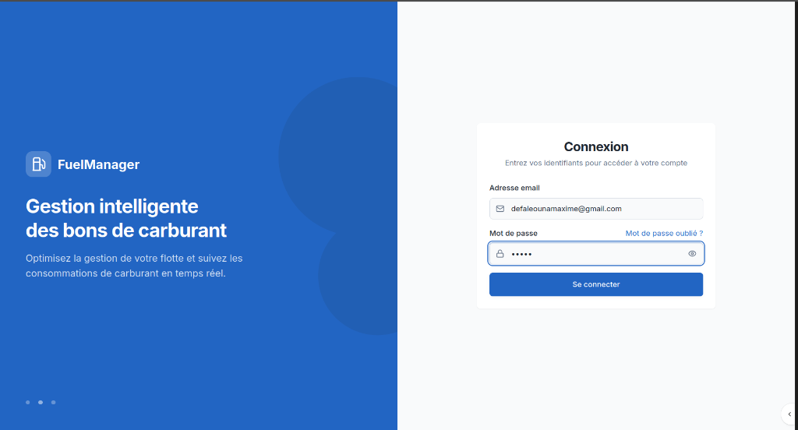
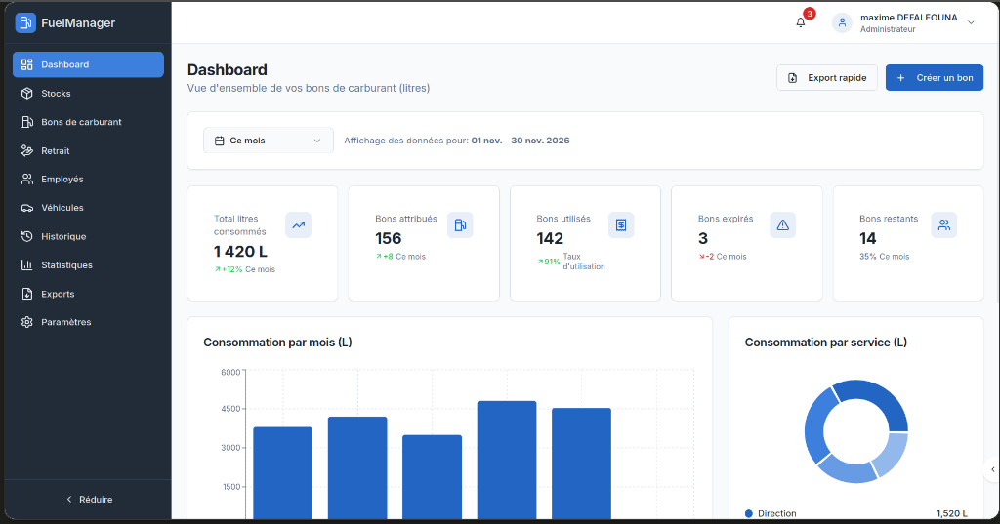
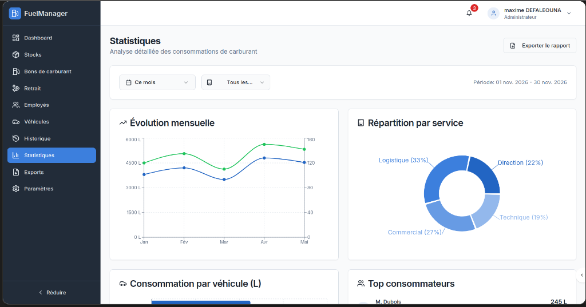

# FuelManager - Solution Intelligente de Gestion des Bons de Carburant et de Flotte

Application d'entreprise concue et developpee sur mesure a la demande d'une entreprise locale pour moderniser, digitaliser et securiser l'ensemble du cycle d'attribution, de suivi et de consommation des bons de carburant.

Cette plateforme met fin a la gestion manuelle par carnets papier, elimine les risques de perte ou de fraude, et offre a la direction une visibilite financiere et logistique en temps reel sur l'usage du carburant par vehicule et par departement.

---

## Contexte et Problematique d'Entreprise

Dans la gestion quotidienne des entreprises disposant d'un parc de vehicules et d'equipes mobiles (commerciaux, chauffeurs, techniciens, logistique), l'usage traditionnel des bons de carburant sur support papier presente des failles critiques :
- Manque de tracabilite sur les volumes reels distribues et consommes.
- Impossibilite d'identifier rapidement les vehicules surconsommateurs ou les anomalies de kilometrage.
- Lourdeur du rapprochement mensuel des factures avec les stations-service partenaires.
- Risques eleves de doublons, de falsifications et de depassements budgetaires.

FuelManager a ete developpe comme une reponse operationnelle directe a ces defis, offrant un outil centralise, ergonomique et hautement securise.

---

## Apercu Visuel de la Solution

### 1. Portail de Connexion et Securite
Interface d'authentification robuste avec controle d'acces par role, garantissant que seuls les gestionnaires et administrateurs habilites peuvent acceder aux donnees sensibles de l'entreprise.



### 2. Tableau de Bord de Pilotage Operationnel
Vue synthetique actualisee en temps reel donnant un acces immediat aux indicateurs cles : volume total de litres consommes, quantite de bons attribues, utilises, expires ou restants, ainsi que la repartition globale par service.



### 3. Analyses Statistiques et Reporting Decisionnel
Graphiques d'aide a la decision permettant d'analyser l'evolution mensuelle des consommations, la part relative de chaque departement, les consommations individuelles par vehicule et le classement des collaborateurs les plus consommateurs.



---

## Fonctionnalites Cles de la Solution

### Pilotage des Bons et Dotations
- **Emission et attribution de bons** : Generation de bons numeriques avec montant en litres ou valeur financiere, attribution ciblee a un employe et affectation a un vehicule precis.
- **Gestion du cycle de vie** : Suivi rigoureux des statuts (attribue, valide en station, expire, annule).
- **Gestion des stocks de carburant** : Vue d'ensemble sur les dotations globales achetees aupres des compagnies petrolieres et suivi des soldes disponibles.

### Gestion de Flotte et des Equipes
- **Parc de vehicules** : Repertoire complet des vehicules (immatriculation, modele, service d'affectation, type de carburant, historique d'entretien et de plein).
- **Gestion des collaborateurs** : Profils des employes autorises a retirer du carburant, rattachement hierarchique et quotas de dotation.
- **Module de retrait en station** : Enregistrement detaille lors du passage a la pompe (date, heure, kilometrage au compteur, litrage servi).

### Audit, Tracabilite et Exports
- **Journal d'audit complet (Historique)** : Journalisation inalterable de toutes les actions effectuees (creation, attribution, validation de retrait, modification) pour garantir une transparence financiere totale.
- **Rapports et exports comptables** : Generation et exportation en un clic des rapports mensuels ou periodiques (formats exploitables pour la comptabilite et le controle de gestion).

---

## Stack Technique

| Categorie | Technologies |
| :--- | :--- |
| **Framework & Langage** | React 18, TypeScript, Vite |
| **Design System & UI** | Tailwind CSS, Shadcn UI, Radix UI Primitives, Lucide Icons |
| **Visualisation de Donnees** | Recharts (Graphiques en barres, beignets, courbes analytiques) |
| **Gestion des Formulaires** | React Hook Form, Zod |
| **Gestion d'Etat & Cache** | TanStack React Query |
| **Utilitaires Dates & UI** | Date-fns, Sonner (Notifications toasts), Class Variance Authority |

---

## Installation et Lancement

### 1. Prerequis
- Node.js (version 18 ou superieure)
- npm, yarn ou bun

### 2. Cloner le depot
```bash
git clone https://github.com/maximedefaleouna/fuel-pass-manager.git
cd fuel-pass-manager
```

### 3. Installer les dependances
```bash
npm install
```

### 4. Demarrer l'application en developpement
```bash
npm run dev
```
L'application sera accessible localement a l'adresse indiquee par Vite (generalement `http://localhost:5173`).

### 5. Compiler pour la production
```bash
npm run build
```

---

## Auteur

**Maxime DEFALEOUNA**
- Profil GitHub : [@maximedefaleouna](https://github.com/maximedefaleouna)
